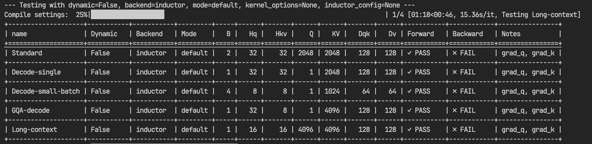
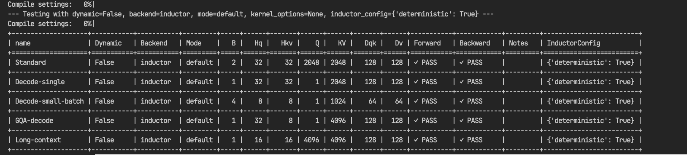
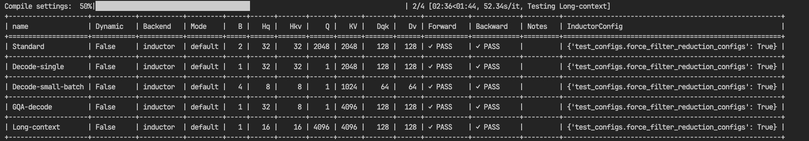

# FlexAttention Determinism

Run-to-run determinism is important for workloads such as long reinforcement-learning rollouts and Mixture-of-Experts models. This guide explains how to make FlexAttention produce bitwise-identical results across repeated runs on the same hardware and software stack.

The accompanying [`examples/flex_attention/flex_determinism.py`](https://github.com/meta-pytorch/attention-gym/blob/main/examples/flex_attention/flex_determinism.py) script tests the behavior described below across standard attention, decoding, grouped-query attention, and long-context shapes.

!!! note
    This guide covers repeatability between runs with the same environment. It does not guarantee bitwise equivalence across different PyTorch or compiler versions, GPU architectures, or kernel configurations.

## Recommended settings

### Forward pass

Use static shapes and Inductor's default compilation mode:

```python
compiled_flex_attention = torch.compile(
    flex_attention,
    dynamic=False,
    backend="inductor",
    mode="default",
)
```

### Forward and backward passes

Also enable deterministic Inductor reductions:

```python
import torch
import torch._inductor.config
from torch.nn.attention.flex_attention import flex_attention


torch._inductor.config.deterministic = True

compiled_flex_attention = torch.compile(
    flex_attention,
    dynamic=False,
    backend="inductor",
    mode="default",
)
```

`torch._inductor.config.deterministic = True` is required for backward-pass determinism because FlexAttention's backward graph contains a reduction whose configuration can otherwise vary during autotuning.

## Sources of numerical variation

Several compiler and kernel choices can affect bitwise results.

### Autotuning

With modes such as `max-autotune-no-cudagraphs`, Inductor benchmarks multiple kernel configurations. If several configurations perform similarly, normal benchmark noise can change which configuration wins. Different block sizes or reduction strategies can perform floating-point operations in a different order, producing different bit patterns.

Resource contention can have the same effect: a competing workload may temporarily slow one candidate and change the selected configuration.

### Dynamic shapes

FlexAttention lowering uses known sequence lengths to choose block sizes and divisibility assumptions. Static and dynamic compilation can therefore produce kernels with different numerical behavior even when they receive tensors with the same concrete shapes.

Use `dynamic=False` when bitwise repeatability is required, and keep the shape and compilation settings consistent between runs.

### Gradients for captured buffers

When a `score_mod` captures buffers that require gradients, the backward pass may use atomics to accumulate those gradients. Atomic accumulation order is not deterministic. This only applies when differentiating captured buffers; it is not part of the common query, key, and value gradient path.

## Why backward needs deterministic reductions

The FlexAttention backward pass first computes a delta term equivalent to `sum(output * grad_output)`, then uses it in the main backward kernel. This reduction is generated by Inductor rather than by the main FlexAttention kernel.

Reduction order matters for floating-point arithmetic. If autotuning selects a different reduction configuration, the delta tensor can change at the bit level. Query and key gradients depend on delta, while value gradients do not. In testing, this appeared as deterministic forward output and value gradients but non-deterministic query and key gradients.

The following run deliberately randomized autotuning choices and exposed the issue:



Enabling Inductor's deterministic mode made both forward and backward results repeatable:



The diagnosis was also confirmed with Inductor's testing-only `force_filter_reduction_configs` option, which restricts reduction autotuning to a consistent configuration:



These `test_configs` options are intended for PyTorch compiler testing and diagnosis. Use `torch._inductor.config.deterministic = True` in application code instead.

## Determinism and performance

FlexAttention often benefits from `max-autotune-no-cudagraphs` because the best kernel configuration depends on the specific `score_mod`, `mask_mod`, shape, and hardware. However, selecting a configuration at runtime introduces another source of run-to-run variation.

For both performance and determinism:

1. During development, benchmark with `max-autotune-no-cudagraphs` to find a good configuration for the production workload.
2. Record the selected FlexAttention kernel settings.
3. In production, compile with `mode="default"` and pass the recorded settings through [`kernel_options`](https://docs.pytorch.org/docs/stable/nn.attention.flex_attention.html#torch.nn.attention.flex_attention.FlexKernelOptions).
4. Keep `dynamic=False` and enable `torch._inductor.config.deterministic` when backward-pass determinism is required.

Pinning `kernel_options` prevents FlexAttention's main kernels from changing configuration, while deterministic Inductor mode fixes the reduction configuration used by the surrounding backward graph.

## Reproducing the tests

Run the repository's determinism example on a CUDA system:

```bash
python examples/flex_attention/flex_determinism.py
```

The script resets compiler state and uses fresh Inductor caches between runs so that it tests repeatability across independent compilations rather than repeatedly executing one cached kernel.

## Autotuned kernels

Autotuned kernels benchmark candidates on a winner-cache miss and reuse the winner.
Candidates differ in floating-point order (tile sizes, warps per block), so timing noise can
change the selected configuration and output bits across processes, ranks, and winner-cache
states.

Every operation that tunes can also launch pinned configurations chosen without timing:

- `torch.use_deterministic_algorithms(True)` disables autotuning. Operations resolve the flag;
  autograd backward resolves it again because eager code can change the mode after forward.
  `gather_attn` resolves it inside its CUDA op implementations at launch.
- `kernel_options={"autotune": False}` pins one call of any operation that tunes: `chunk_kda`,
  `paged_chunk_kda`, `recurrent_kda`, `chunk_gdn`, `paged_chunk_gdn`, `recurrent_gdn`,
  `l2norm`, the context-parallel and staged chunk operations, and `gather_attn`.
  `paged_mla_decode` tunes only with `{"autotune": True}`.

Tuning needs one eager call per workload before CUDA graph capture: a capture that reaches an
untuned kernel raises `RuntimeError`. Capture with `{"autotune": False}` to skip the warm-up.

Upgrading from a release that took `autotune=` as a keyword: pass
`kernel_options={"autotune": ...}` instead. Winners from Triton's own autotune cache are not
reused, so each workload tunes once more after the upgrade.

The pinned configuration follows the input shapes and GPU model. For otherwise deterministic
kernels, bits repeat across processes and cache states on one GPU model and software stack,
not across GPU architectures.

## KDA determinism

The Triton fused KDA kernels contain no atomics, so every kernel is bitwise-deterministic
given a fixed configuration. The warpdrive kernels, the default chunk backend on SM100-family GPUs,
follow their own rules ([warpdrive chunk kernels](#warpdrive-chunk-kernels)). The guarantees of
the fused kernels, strongest first:

- **Same selected configurations, run to run: bitwise.** Repeating a call
  that resolves to the same kernel configurations — across runs and processes —
  reproduces identical bits for outputs and gradients. Under default
  autotuning, a cold winner cache re-benchmarks and timing noise may
  select a different configuration; the next bullet removes that variable, as do
  deterministic algorithms (see [Autotuned kernels](#autotuned-kernels)).
- **`chunk_kda(..., kernel_options={"autotune": False})`: bitwise by construction.** The
  default benchmarks candidate configurations of every Triton stage on a winner-cache miss and
  reuses the cached winner afterwards; `{"autotune": False}` pins every stage to its fixed heuristic
  configuration instead, so kernel selection is repeatable across processes and
  cache states. With the same option, `recurrent_kda` uses its host shape heuristic without
  tuning. `causal_conv1d` never benchmarks: it launches fixed default schedules
  unless `kernel_options` names others, so it has no `autotune` key.
- **`recurrent_kda` and `recurrent_gdn` with `kernel_options={"batch_invariant": True}`:
  bitwise across batches.** On one GPU model and software stack, a sequence gets
  the same output and final-state bits alone, among empty slots, or decoded one
  token per call with an FP32 state pool (a BF16 pool rounds the state between
  calls). The scan picks its launch
  configuration from the batch shape, so `{"autotune": False}` alone does not give
  this. The option makes the configuration irrelevant: one formula for every
  configuration, sums over K in a fixed order, and no FMA fusion. `l2norm` makes
  the same split: its forward always reduces in a fixed order, and its `autotune`
  option only pins the backward configuration. Autotuning and prefetching still
  run. The option costs up to ~20% GPU time on long prefills and ~9% on decode
  (GB300). The fused decode ops (`recurrent_kda_decode`, `recurrent_gdn_decode`)
  do not support it. For batch-invariant decode, apply `gate_transform`, the beta
  sigmoid and `l2norm` yourself, then call the scan with one token per sequence.
- **CUDA-graph replay: bitwise** by construction, and the intended serving mode
  for decode.
- **Across lowerings: never bitwise.** Dense versus packed, chunked versus
  recurrent, and fused versus reference are different kernels with different
  reduction orders. They agree numerically, not bit-for-bit — for example, the
  dense and packed chunk lowerings match bitwise everywhere except the FP32
  gradient at the internal chunk-scan boundary, whose software reduction chains
  compile with different schedules.

The reference implementations compute in FP32 even inside an autocast region.

## warpdrive chunk kernels

On SM100-family GPUs, `chunk_kda`, `chunk_gdn`, their paged, staged and context-parallel forms run
the warpdrive kernels by default ([Chunk backend selection](linear.md#chunk-backend-selection)).
Pass `kernel_options={"backend": "fused"}` to get the fused guarantees above instead.

- **Run to run: bitwise.** warpdrive does not autotune, so `{"autotune": False}` and
  `torch.use_deterministic_algorithms(True)` change nothing and no tuning warm-up is needed.
  Its atomics only claim work items and append rows to its work tables; repeating a call with
  the same inputs and shapes reproduces the output, final-state and gradient bits
  (`test/test_linear_default_backend.py`).
- **Across batch compositions: not bitwise.** The plan (forward and backward piece chains, the
  KDA value split and its prep pass, the piece length of the staged and context-parallel
  summaries) follows the packed shape and the SM count, so a sequence's bits can change with
  the other sequences packed beside it, and between GPU models with different SM counts.
  [Document-aligned fragments](linear.md#document-aligned-fragments-cp-invariant-bits) gives
  measured examples.
- **Against the fused backend: never bitwise.** KDA chunks at 16 tokens on warpdrive and at 64
  on the fused kernels; GDN chunks at 64 on both but with different kernels.
- **CUDA-graph replay: bitwise** for the same inputs. A graph captured at a larger capacity
  keeps the plan of its captured shape, so its replays need not match an eager call at the
  replayed size bit for bit.


## References

- [FlexAttention API reference](https://docs.pytorch.org/docs/stable/nn.attention.flex_attention.html)
- [FlexAttention determinism test script](https://github.com/meta-pytorch/attention-gym/blob/main/examples/flex_attention/flex_determinism.py)
- [Inductor deterministic configuration](https://github.com/pytorch/pytorch/blob/901bbcba122825c817cac9e0b88221096fcd74ae/torch/_inductor/config.py#L712)
- [Inductor benchmark-distortion test configuration](https://github.com/pytorch/pytorch/blob/901bbcba122825c817cac9e0b88221096fcd74ae/torch/_inductor/config.py#L2102)
- [Inductor reduction-filter test configuration](https://github.com/pytorch/pytorch/blob/901bbcba122825c817cac9e0b88221096fcd74ae/torch/_inductor/config.py#L2094)
- [PyTorch reduction determinism fix](https://github.com/pytorch/pytorch/pull/165729)
