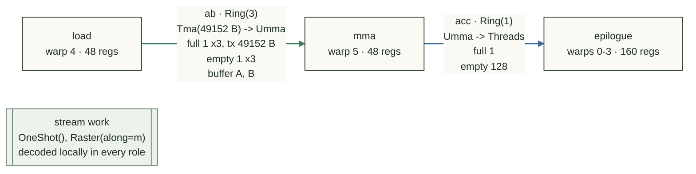
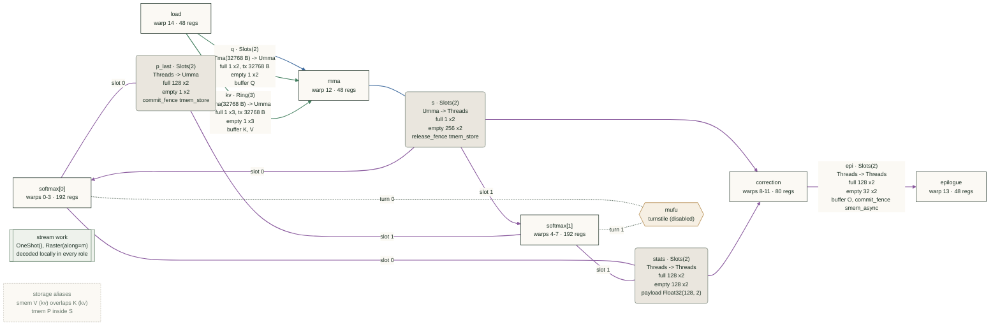
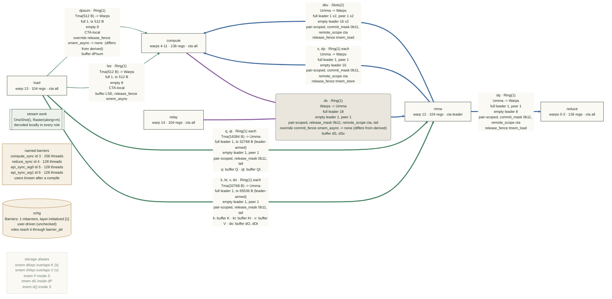
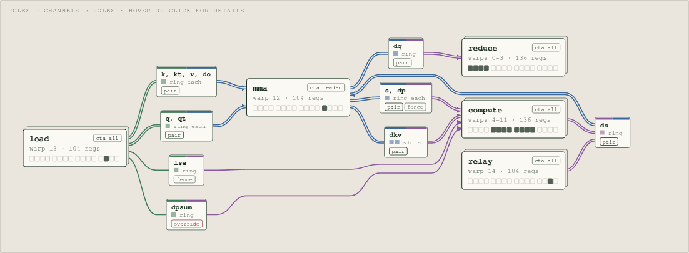
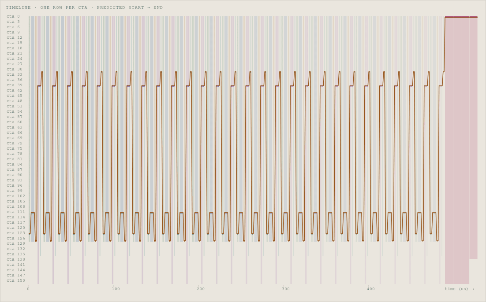
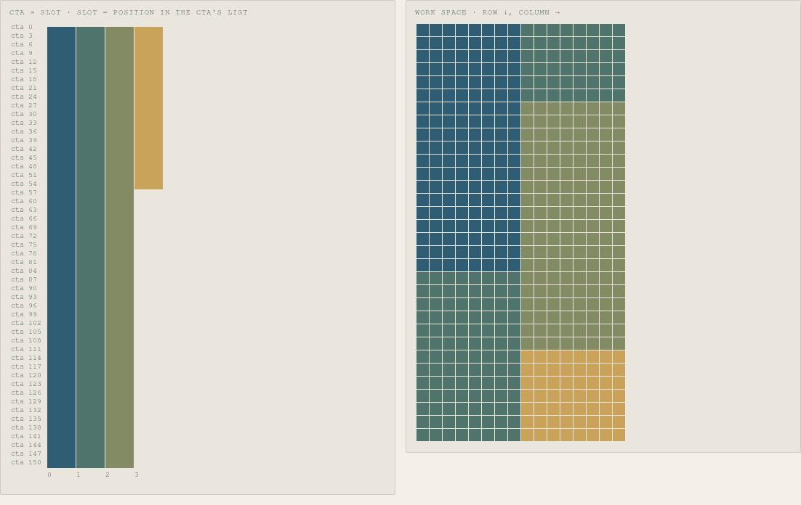

# Tracing

[Back to warpdrive](index.md)

Start with `op.describe()` to inspect the kernel, or [IKET](profiler.md#quick-start) to see
when its roles run. The built-in examples support both without changes to their role bodies.

| Question | View | What it records |
|---|---|---|
| Who runs, signals and owns storage? | [`describe()`](#inspect-the-kernel), or [as a graph](#draw-the-pipeline) | Declarations and available compile diagnostics |
| Where does a handle open and close? | [Protocol trace](#trace-the-protocol) | Traced code sites, not runtime iterations |
| When does a role work or wait? | [Tracing backends](#tracing-backends) | Instrumented runtime ranges |
| How do those ranges relate to channels? | [Pipeline plan](#join-a-capture-to-the-pipeline-plan) | A per-CTA, work-item model |

These views help diagnose a kernel; see the [limits of each check](guarantees.md).

## Inspect the kernel

```python
from attn_gym.warpdrive import ClusterLaunchControl, CtaPair
from attn_gym.warpdrive.examples.persistent_gemm import (
    PersistentGemm,
    compile_persistent_gemm,
)

op = PersistentGemm(schedule=ClusterLaunchControl(), cluster=CtaPair())
print(op.describe())
compile_persistent_gemm(op)
print(op.describe())
```

The first print checks declarations. The second adds compile results, including reports
restored by `jit_cache`. This excerpt is for pair GEMM with CLC and default `tile_n=224`;
print your build for current placement, stages and source lines:

```text
PersistentGemm: 8 warps, 256 threads
  cluster  CTA pair (2, 1, 1), tcgen05 CtaGroup.TWO, leader = rank 0
  params   PersistentGemmParams

Roles
  warps  role            regs  cta     raw
  0-3    epilogue         160  all
  4      load              40  all
  5      mma               40  leader
  6      work.scheduler    40  leader
  7      (padding)         40

Channels
  ab         Ring(6)  load -> mma
             signal    Tma(30720 B) -> Umma
             full      leader 1 x6, tx 61440 B (leader-armed)
             empty     leader 1 x6, peer 1 x6
             scope     pair-scoped, release_mask 0b11, tail
             storage   buffer A, B
             tma       verified CtaGroup.TWO, 30720 B/stage per CTA @ persistent_gemm.py:194,195
  acc        Ring(2)  mma -> epilogue
             signal    Umma -> Threads
             full      leader 1 x2, peer 1 x2
             empty     leader 256 x2
             scope     pair-scoped, commit_mask 0b11, remote_scope cta
  work_ring  Ring(2)  work.scheduler -> epilogue, load, mma, work.scheduler
             signal    Tma(16 B) -> Threads
             full      leader 1 x2, peer 1 x2, tx 16 B (leader-armed)
             empty     leader 384 x2
             scope     pair-scoped, remote_scope cta
             storage   payload Int32(4,)
  work_clc   Slots(1) work.scheduler -> work.scheduler
             signal    Tma(16 B) -> Threads
             full      1, tx 16 B
             empty     32
             scope     CTA-local
             storage   payload Int32(4,), release_fence smem_async

Streams
  work  ClusterLaunchControl(stages=2), Raster(along=m, swizzle=8)
        scheduler warp 6 broadcasts over work_ring
        roles: epilogue, load, mma

TMEM: 448 columns used, 512 allocated
  tmem acc [0, 224), [224, 448)

SMEM plan: 200704 B per CTA in 3 buffer(s), plus alignment padding
  A  BFloat16  98304 B  6 stages (mode -1)  align 1024  -> ab
  B  BFloat16  86016 B  6 stages (mode -1)  align 1024  -> ab
  C  BFloat16  16384 B                      align 128
```

Read one channel at a time:

- **`ab`:** each CTA receives 30 KiB of A/B per stage. The leader arms 60 KiB for the pair;
  `1 x6` means one arrival at each of six FULL barriers. After reading, the MMA releases
  both CTAs (`release_mask 0b11`).
- **`acc`:** UMMA completion publishes to both CTAs. Its leader-owned EMPTY barrier waits
  for `2 * 128 = 256` epilogue threads before reuse.
- **`work_ring`:** the scheduler in the padding warpgroup broadcasts each CLC claim to all
  roles in both CTAs. `work_clc` is its response slot. These names derive from stream `work`:
  `work.scheduler`, `work_ring`, `work_clc`.
- **Storage:** SMEM buffers hold data; barriers track readiness. `SmemPlan` adds sizes,
  stage modes, overlaps and channel bindings after layouts are traced, plus the
  [alias diagnostic](storage.md#check-declared-aliases) for declared overlaps.

`describe()` returns a string, not a runtime history. Its [liveness report](guarantees.md#liveness)
names the counts and assumptions checked. For a timeout, locate the stuck wait's CTA, role
and epoch before assigning a cause.

### Read check results as data

Use `op.checks()` for structured verdicts from the same reports:

```python
checks = op.checks()
checks.channels["ab"].tma  # "verified"
checks.channels["acc"].tma  # None: no TMA check
checks.aliases  # {("P", "S"): "no hazard found", ...} for declared overlaps
```

| Field | Values | `describe()` line |
|---|---|---|
| `channels[name].tma` | `"verified"`, `"unverified"`, `"opted out"`, `"no copies"`, `"not checked yet"`; `None` without a [TMA check](#tma-checks) | `tma` |
| `channels[name].epochs` | `"verified"`, `"unverified"`, `"not checked yet"`; `None` without round-robin or exclusive sharing | `epochs` |
| `aliases[(name, overlapped)]` | `"no hazard found"`, `"unverified"`, `"potential hazard"`; empty before a compile or with `alias_check="off"` | `name ~ overlapped` in the alias diagnostic |
| `fences[(channel, "commit_fence" or "release_fence")]` | `"covered"`, `"unverified"`, `"missing fence"` per explicit fence; empty before a compile or with `alias_check="off"` | the [fence check](channels.md#checking-explicit-fences) |
| `liveness` | `"verified"`, `"no deadlock found"`, `"unverified"`, `"possible deadlock"`, `"error"`; `None` before compilation or with `liveness_check="off"` | `liveness` |

`describe()` supplies the evidence: copy sites, byte counts, epoch shares and findings.
`"not checked yet"` means the instance has neither compiled nor restored a report.

## Tracing backends

```python
from attn_gym.warpdrive import StaticPersistent

op = PersistentGemm(schedule=StaticPersistent()).enable_trace("iket", waits=False)
fn = compile_persistent_gemm(op)
```

Enable tracing before compiling. Start with `"iket"` (`enable_iket()` is shorthand) and
`waits=False` to limit instrumentation overhead. The layer adds named ranges for you;
the [profiler quick start](profiler.md#quick-start) shows a complete capture.

- Roles taking `WorkCursor`: one range per work item, ending at `advance()`.
- Other roles: one range over the body. Instance names remain distinct, e.g. `softmax[0]`.
- Default `waits=True`: nested ranges such as `ab.acquire`, `ab.wait`, `ab.tail`, `q.peek`,
  `mufu.turn` and `compute_sync.sync` for a `NamedBarrier`.
- Try-token probes have no range. The subsequent wait keeps its range, empty if the probe
  already succeeded.
- Your regions, inside a role: `with self.trace_region("exp", payload=row):`. The optional
  payload is a runtime `Int32`, such as the work item the region belongs to.

| | `"iket"` | `"globaltimer"` |
|---|---|---|
| Records | every warp, with NVIDIA's `run-iket` | lane 0 of each role instance's first warp, into a profile buffer |
| Kernel | unchanged | passes an int64 buffer: `self.run_roles(ctx, trace_buffer=trace)` |
| Capture | `run-iket` around a script that launches once | `trace_session(op, num_ctas)` around a launch |
| Result | IKET JSON/Perfetto; `parse_iket(path)` decodes it into the profiler's `Range`s | `session.ranges`; a Perfetto trace with one process per CTA and one track per role |
| Payloads | `trace_region`'s, as the range's `payloadVal` (`Range.payload`) | `trace_region`'s and each work item's index, as `Range.payload` |

Conceptual timeline (not a measured capture):

```text
load item 0: [ab.acquire][issue copies] ...
mma  item 0:       [----- ab.wait -----][MMA] ...
                          waiting for FULL
```

A wide `ab.wait` says the consumer waited for data; a wide `ab.acquire` says the producer
waited for storage reuse. Neither alone identifies the bottleneck. Match the CTA, role and
epoch to the other side before attributing the delay; overlapping waits are not additive
kernel time.

Disabled tracing emits no instructions. The cache key includes the backend and whichever
`waits`/`events_per_role` settings affect code. `trace_key()` supplies the examples' suffixes:
`_iket`, `_iketroles`, `_gtimer`, `_gtimerroles`.

Ranges must nest. Closing an outer range first—for example, advancing a work cursor inside
`trace_region`—raises `ProtocolError` at trace time.

### IKET

Use NVIDIA's `run-iket` with a script that launches the traced kernel once.
`profile_kernel.py` below is your script; the [quick start](profiler.md#quick-start) supplies
one. This command also produces JSON for analysis:

```bash
CUTE_DSL_NO_CACHE=1 run-iket -o traces/gemm --clobber profile --postprocess all -- python profile_kernel.py
```

Use a fresh process: this flag bypasses disk caching, not existing in-memory builds.
IKET permits ranges outside roles. Its work-item ranges carry no payload.

### Role summary

`role_summary(ranges, op=None)` reports work items, p50/p90 item time and the share spent in
wait ranges (`*.acquire`, `*.wait`, `*.peek`, `*.tail`, `*.turn`, `*.sync`). Nested waits count
once. Without `op`, outermost non-wait ranges identify roles on each warp; with it, rows use
the declared roles and their first warps. For a persistent GEMM IKET capture:

```python
from attn_gym.warpdrive.profiler import parse_iket
from attn_gym.warpdrive.trace_session import role_summary

print(role_summary(parse_iket("traces/gemm/capture.trace.json")))
```

Wait time needs `waits=True`; otherwise 0% means unrecorded, not wait-free. Without `op`,
IKET lists every recorded warp; globaltimer records only the first warp of each role.
Overlapping waits across roles are not additive kernel time.

### globaltimer

Use `globaltimer` when the kernel accepts a trace buffer. Among the examples, only the Qwen
megakernel does; enabling it on the others raises `ProtocolError` at compile time.

Pass the buffer through to `run_roles`. Keep the argument in every build, compiled from a
fake `Int64` tensor of shape `(cute.sym_int(),)`; disabled tracing ignores it.

```python
@cute.kernel
def kernel(self, ..., trace: cute.Tensor, bound):
    self.begin_roles(work=bound)
    ...
    self.run_roles(ctx, trace_buffer=trace)
```

```python
from attn_gym.warpdrive.profiler import summarize_by_tag
from attn_gym.warpdrive.trace_session import trace_session

op = MyKernel().enable_trace("globaltimer", waits=False)
fn = compile_my_kernel(op)  # compile first: the range names come from the trace
with trace_session(op, num_ctas, trace_path="kernel.pftrace") as session:
    fn(..., session.prof.tensor, ...)
print(summarize_by_tag(session.ranges)["mma"])
```

`trace_session` wraps `profile_session`. Each decoded `Range` holds its `name`, `cta=(c,)`,
the role's first `warp`, and payload. The backend uses full records: two `%globaltimer` reads
and four 8-byte stores per range. Start times sit in SMEM (8 bytes per nesting level and
role), not registers held across the range.

Each CTA gets `events_per_role` slots per role instance (default 1024). Excess ranges are
dropped with a `trace_session` warning. A buffer smaller than the grid records only the first
CTAs.

`trace_session.write_trace(path, op, session.ranges, name=..., args=..., flows=...)` writes one
process per CTA and one track per role, forwarding options to the profiler's `write_ranges`.
The [Qwen megakernel](examples.md#qwen3-decode-megakernel) uses this to link instruction rows
across CTAs.

`work_item_ranges(session.ranges, role)` keys each work item's range of `role` by its payload,
the work index; `work_item_spans(session.ranges, role)` turns them into `[item, cta, start,
end]` in us from the earliest start, the measured spans `schedule_html` draws.

## Draw the pipeline

`describe(format="mermaid")` draws a [Mermaid](https://mermaid.js.org/) flowchart that GitHub
renders in Markdown. `format="dot"` gives Graphviz DOT (`dot -Tsvg`). Neither needs a compile;
after compilation, both add TMA status, epoch ownership and named-barrier users.

```python
print(op.describe(format="mermaid"))
```

- **Roles** show each instance's warps, registers, CTA placement and `raw` flag.
- **Channels** point from producer to consumer. Labels show stages, mechanisms, FULL/EMPTY
  counts, scope, sharing and storage. Colours identify signals: TMA green, UMMA blue,
  threads/warps purple, named barriers ochre. Thick edges cross CTAs; thin edges stay local.
  Multi-role or slot-bound channels use a junction, with outgoing edges in each consumer's
  colour. Channels differing only in name/storage share an edge (`k, kt, v, do ... each`).
- **Other synchronization** uses ochre hubs and dotted lines: named barriers (`sync`,
  `arrive`, `native id`), turnstiles (`turn i`) and `Barriers`. Before compilation, named
  barriers share one box because their users are unknown. `Barriers` edges track role
  parameters, not `barrier_ptr` calls.
- **Other nodes** show external `raw code`, native named-barrier calls from `kernel code`,
  work streams and their broadcast schedulers, and SMEM overlaps/shared buffers/TMEM aliases.

The diagrams below are the uncompiled output for the single-CTA GEMM, FA4 forward and the
2-CTA FA4 backward; print your build for current values.

**GEMM** (`attn_gym/warpdrive/examples/gemm.py`): TMA → MMA → epilogue.



**FA4 forward** (`attn_gym/warpdrive/examples/fa4_fwd.py`): each softmax instance owns one slot of `s`,
`p_last` and `stats`; `mufu` (off by default, `turnstile=True`) makes them take turns
around exp2.





**2-CTA FA4 backward** (`FlashAttentionBackward2Cta` in `attn_gym/warpdrive/examples/fa4_bwd.py`): every
MMA-facing channel is pair-scoped, and the leader-only MMA warp issues for both CTAs. In
the dS exchange each CTA's compute warps copy half of dS into the peer's SMEM; the copy
completes on the peer's raw `xchg` barrier, and its `relay` warp forwards that arrival to
the leader on `ds`. Hence `ds` joins compute and relay.



### Draw it as a page

`describe(format="html")` returns a self-contained HTML page. Save it and open it from disk;
no network access is needed:

```python
Path("fa4_bwd_2cta.html").write_text(op.describe(format="html"))
```



Role cards show warps, registers and CTA placement; stacked cards run on every CTA. Channel
chips show one tick per stage and badges for scope, multicast, fences, overrides, sharing
and compile results. Overrides that differ from derived values are red. Incoming wires use
the producer's colour; outgoing wires use the consumer's. Double wires cross CTAs.

Hover or click cards, chips and synchronization hubs for full labels. Work streams, named
barriers with unknown users and storage aliases appear below the figure.

### See which CTA runs what

For `OneShot`, `StaticPersistent` or `TilePersistent`, call
`WorkStream.assignment(space, max_ctas)` to list each work unit's items in schedule order:
`[cta][slot] -> (index, item)`. `Raster` decodes items itself. For mappings that read tables or
device data, supply a host `decode=` that also identifies dropped items.

```python
rows = PersistentGemm().work.assignment((32, 16, 1), max_ctas=148)
rows[0]  # [(0, (0, 0, 0)), (148, (18, 4, 0)), ...]: CTA 0's tiles, in order
```

`schedule_html` draws a CTA × slot grid; a ragged last column shows wave quantization.
Items with predicted spans also get a timeline (drag to zoom, click a row to focus a CTA),
dependency arrows on hover, a critical path with a per-segment table, and an optional measured
overlay drawn as a second lane per CTA. Items with 2-D coordinates get a work-space map.
Two examples use it:

```bash
# persistent GEMM tiles per CTA and a grouped GEMM's groups
python -m attn_gym.warpdrive.examples.schedule_views OUTDIR --ctas 152
# the Qwen megakernel's instruction table under its latency model; --timeline overlays a
# trace="globaltimer" capture (overlay() in the module docstring writes it)
python -m attn_gym.warpdrive.examples.qwen_megakernel_viz OUT.html --model Qwen/Qwen3-32B --ctas 152
```





## Trace the protocol

```python
op = PersistentGemm(schedule=ClusterLaunchControl(), cluster=CtaPair())
op.trace_protocol = True  # before the first describe() or compile
compile_persistent_gemm(op)
print(op.describe())
```

This logs acquire/commit/wait/release **sites and source lines**, not runtime iterations.
Use it to follow a handle from open to close. Use IKET to locate runtime stalls.

The examples compile `trace_protocol` builds with `jit_cache(uncached=...)`: a cache hit
would skip the trace. Other saved reports are restored on a hit; see
[compile keys](roles.md#compile-keys).

### TMA checks

Pass `h.barrier` as `tma_bar_ptr=` for tensor loads or `mbar_ptr=` for bulk
`CopyBulkG2SOp` / `CopyBulkG2SMulticastOp` loads. Use `Cluster.multicast` for masks so the
checker can relate the copy to the channel declaration. The report names copy sites,
CTA groups and counted bytes per stage per CTA; bulk copies appear as `cp.async.bulk`.

Bulk copies do not elect a lane themselves: issue them inside `elect_one()` and give them
flat contiguous views. See [TMA checks](guarantees.md#tma) for recognized mismatches,
unverified uses and the separate context check.

## Join a capture to the pipeline plan

```python
from attn_gym.warpdrive import plan_from_warpdrive
from attn_gym.warpdrive.profiler import parse_iket
from attn_gym.warpdrive.profiler.pipeline import (
    analyze_pipeline,
    join,
    write_pipeline_perfetto,
)

plan = plan_from_warpdrive(op, cta=0)  # after compilation, for traced reuse counts
timeline = plan.schedule(iterations=8)  # the work items the joined CTA ran
measured = join(parse_iket("capture.trace.json"), timeline, cta=(0, 0, 0))
analysis = analyze_pipeline(timeline, measured)
write_pipeline_perfetto("gemm.pftrace", timeline, measured, analysis=analysis)
```

Use the JSON capture path produced by your IKET run in place of `capture.trace.json`; for a
globaltimer capture, join `session.ranges` with `cta=(c,)`. Open the resulting trace in
[Perfetto](https://ui.perfetto.dev/).

The join is strict: every recording warp must record each of its role's ranges once per
iteration, so `iterations` must be the number of work items the joined CTA ran (the error names
it). A role without a work cursor records one range per launch and joins only a one-iteration
timeline. With `waits=True`, the wait ranges nested in a role's range become its region's
measured wait, which the blocker analysis uses instead of inferring one.

The two `cta` arguments use different coordinates: `plan_from_warpdrive(cta=0)` selects a
**cluster rank**; `join(cta=(0, 0, 0))` selects a **captured logical CTA** (IKET's CTA id, or a
globaltimer profiling unit `(c,)`). Match them. In a pair, a rank-1 plan excludes leader-only
roles; every rank excludes absent roles.

The plan joins names and dependencies, not individual inner-loop stages:

```text
producer region -- data --> consumer region
producer region <-- reuse -- consumer region
                   one iteration = one work item
```

Reuse distances use traced per-item counts (restored by `jit_cache`); before compilation,
each channel is assumed used once per item. Inner K-loop occupancy is therefore coarse.
Within-item feedback that would form a cycle is modeled as next-item feedback, not a
per-stage causal model. Use explicit epochs and runtime waits for that finer question.
The plan's [coverage differs from compile-time checks](guarantees.md#what-a-successful-check-means).

See [Pipeline analysis](profiler.md#pipeline-analysis) for the workflow, or the
[pipeline reference](profiler-reference.md#pipeline-matching-and-analysis) for matching rules
and analysis limits.
